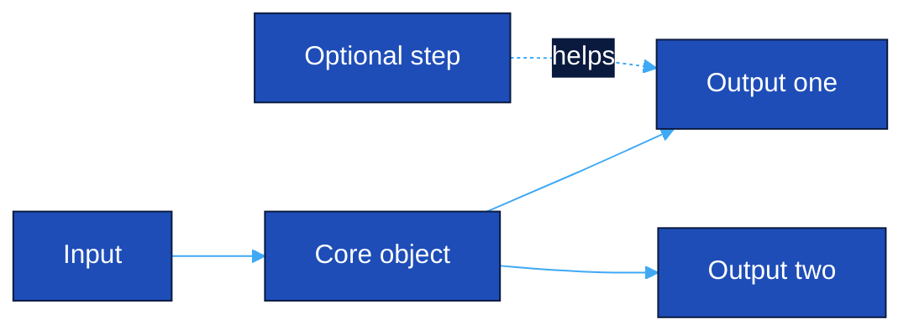
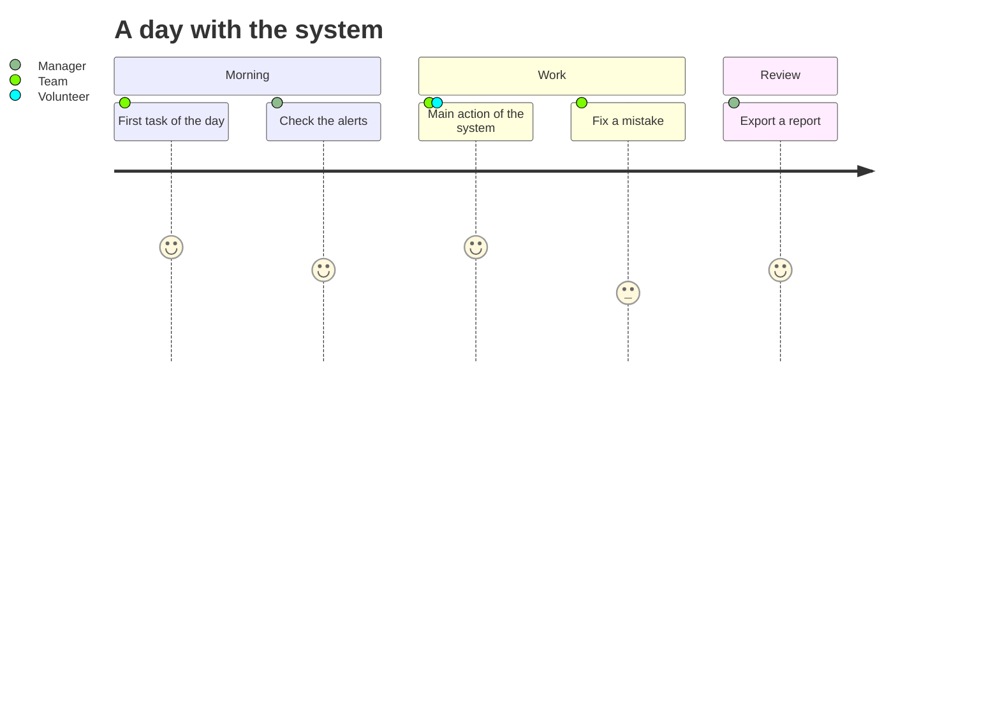
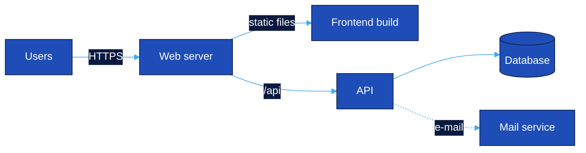

<!--
  SAPPHIRE LAYOUT — modelo de README para SISTEMAS (app, painel, API, serviço com usuários, banco e deploy).

  COMO USAR
  1. Copie a pasta assets/ (que fica na raiz deste repositório, ao lado de Templates/) para a raiz do seu projeto.
     Ela tem o banner.svg, o divider.svg e os botões da barra de links (nav-*.svg)
  2. Neste layout, troque "../assets/" por "assets/" em todas as imagens (busca e substituição do editor).
     Aqui o caminho tem o "../" só para a pré-visualização deste repositório não aparecer quebrada
  3. Abra o banner.svg e troque os textos e as cores (as instruções estão no começo do arquivo). Faça o mesmo com os nav-*.svg
  4. Apague este comentário grande e edite o texto de cada seção, seguindo os comentários pequenos
  5. Remova as seções que o seu projeto não usa, junto com a linha do divisor (a tag de imagem com divider.svg) e o item do índice, se houver

  O QUE TEM DE DIFERENTE DOS OUTROS MODELOS
  - Banner animado em SVG, botões animados na barra de links e cartões de números no topo, em vez de uma fileira de badges
  - Tabela "What do you want to do?" (navegação por tarefa) e o Quick start logo no começo
  - Diagramas Mermaid (o GitHub desenha sozinho), incluindo o de jornada ("A day with the system")
  - Seção "Decisions" (as escolhas do projeto com o motivo) e "When something breaks" (sintoma, causa e solução)
  - Os caminhos das imagens começam com "../assets/" (veja o passo 2 acima)
  - Títulos sem emoji de propósito: assim o link para cada seção (#quick-start etc.) funciona sem gerar id manual

  CUIDADOS
  - Os links internos usam o texto do título em minúsculas e com hífen (## Quick start vira #quick-start). Se mudar o título, mude o link
  - O Mermaid precisa de uma linha em branco antes e depois do bloco. O GitHub mostra erro se a sintaxe estiver errada
  - O diagrama de linha do tempo (timeline) NÃO está confirmado no GitHub, por isso o histórico de versões é uma tabela
-->

<!-- HEADER (troque só o texto do alt e a largura se quiser. O banner é o arquivo assets/banner.svg, edite os textos dele lá dentro) -->
<div align="center">



<br/><br/>

<!--
  BARRA DE LINKS (cada botão é uma imagem SVG animada dentro de um link, porque link dentro de SVG não é clicável)
  - Para trocar o destino: edite só o href do <a>
  - Para trocar o texto do botão: abra o arquivo nav-*.svg dele e siga as instruções no começo (o texto e a largura)
  - Para criar outro botão: copie um nav-*.svg, renomeie, e copie uma linha abaixo trocando href, src e alt
  - Para tirar um botão: apague a linha. Mantenha height="34" em todos para ficarem do mesmo tamanho
-->
<a href="#quick-start"></a>
<a href="#how-it-works"></a>
<a href="#features"></a>
<a href="#roles"></a>
<a href="#decisions"></a>
<a href="#when-something-breaks"></a>
<a href="docs/DEPLOY.md"></a>

<br/><br/>

<!-- CARTÕES DE NÚMEROS (troque o número dentro de <h2> e o rótulo dentro de <sub>. Use de 3 a 5 cartões, com números que sejam fatos do projeto. Para mais ou menos cartões, copie ou apague um bloco <td>) -->
<table>
  <tr>
    <td align="center" width="150"><h2>5</h2><sub>ROLES</sub></td>
    <td align="center" width="150"><h2>12</h2><sub>MODULES</sub></td>
    <td align="center" width="150"><h2>3</h2><sub>LANGUAGES</sub></td>
    <td align="center" width="150"><h2>40</h2><sub>UNIT TESTS</sub></td>
  </tr>
</table>

</div>

<br/>

<!-- AVISO (use só se houver dado real ou risco. Tipos: NOTE, TIP, IMPORTANT, WARNING, CAUTION. Apague o bloco se não precisar) -->
> [!WARNING]
> **Real data.** Say what must never go to the repository, such as the `.env` file, database dumps and keys.

<!-- DIVISOR (esta linha se repete entre as seções. Não precisa editar nada, só apague onde não quiser) -->


<!-- WHAT IT IS (o que o sistema é, em um ou dois parágrafos curtos, e a tabela com os fatos básicos) -->
## What it is

Say in two or three sentences what the system does, for whom and in which context. Start with the problem it solves.

Add one more short paragraph with what the team gets from it day to day.

<!-- TABELA DE FATOS (troque os rótulos e os valores. Mantenha de 4 a 6 linhas) -->
| | |
| :--- | :--- |
| **Who uses it** | The people and the roles |
| **Where it runs** | The server, the domain and how it is served |
| **Built with** | The main technologies |
| **Made by** | Who maintains it and the license |
| **Your data** | Where the data lives and what leaves the server, if anything |

<!-- NAVEGAÇÃO POR TAREFA (a pessoa diz o que quer fazer e vai direto ao lugar certo. Troque as linhas pelos documentos do seu projeto) -->
**What do you want to do?**

| I want to... | Go to |
| :--- | :--- |
| Run the system on my machine | [Quick start](#quick-start) |
| Understand how it works | [How it works](#how-it-works) |
| Put a change online | [docs/DEPLOY.md](docs/DEPLOY.md) |
| Fix something that broke | [When something breaks](#when-something-breaks) |
| Know why it was built this way | [Decisions](#decisions) |


<!-- QUICK START (o caminho mais comum, do clone ao sistema rodando. Só o essencial: o resto vai nos <details> abaixo) -->
## Quick start

You need **Tool one 20+** and **Tool two 14+**.

<!-- Um passo por bloco, com o endereço onde cada parte fica -->
**1. Backend**, at `http://localhost:3000`

```bash
git clone https://github.com/Username/Repository.git
cd Repository/backend
npm install
cp .env.example .env          # set the variables
npm run dev
```

**2. Frontend**, at `http://localhost:5173`, in another terminal

```bash
cd Repository/frontend
npm install
npm run dev
```

**3. Log in** with the user of the seed and change the password at once.

<!-- VARIÁVEIS (recolhido. Liste só as que a pessoa precisa preencher) -->
<details>
<summary><b>Environment variables</b></summary>

<br>

| Variable | What it is |
| :--- | :--- |
| `DATABASE_URL` | The connection to the database |
| `SECRET_KEY` | The key of the login, how to generate one |

</details>


<!-- HOW IT WORKS (diagramas Mermaid. Use de 2 a 4. Cuidado com a sintaxe: uma linha errada faz o GitHub mostrar um erro no lugar do desenho)
     A primeira linha %%{init...}%% aplica as cores do projeto. Troque os HEX (primaryColor = caixas, lineColor = setas) ou apague a linha para o tema padrão -->
## How it works

**The main flow** of the system, from the input to the result:



<!-- JORNADA (um dia de uso do sistema. Formato: "Passo: nota de 1 a 5: quem faz". As notas são só a sensação de uso, 5 é o melhor. Cada section agrupa um momento do dia) -->
**A day with the system**, as the team lives it:



<!-- INFRAESTRUTURA (como roda em produção. Troque os nomes das caixas) -->
**In production**, how it runs:




<!-- FEATURES (seis cartões em grade 3 por 2: emoji + título em negrito + uma frase. Para 3 ou 9 cartões, apague ou copie uma linha <tr>) -->
## Features

<table>
  <tr>
    <td width="33%" valign="top"><b>🎯 Feature one</b><br/>One sentence about what it does for the user.</td>
    <td width="33%" valign="top"><b>📊 Feature two</b><br/>One sentence about what it does for the user.</td>
    <td width="33%" valign="top"><b>🔔 Feature three</b><br/>One sentence about what it does for the user.</td>
  </tr>
  <tr>
    <td width="33%" valign="top"><b>🔎 Feature four</b><br/>One sentence about what it does for the user.</td>
    <td width="33%" valign="top"><b>🧩 Feature five</b><br/>One sentence about what it does for the user.</td>
    <td width="33%" valign="top"><b>🔐 Feature six</b><br/>One sentence about what it does for the user.</td>
  </tr>
</table>

<!-- LISTA COMPLETA (recolhida, uma linha por área. É onde entra o detalhe que não cabe nos cartões) -->
<details>
<summary><b>Everything the system does</b></summary>

<br>

| Area | What it has |
| :--- | :--- |
| **Area one** | What it has, in one line |
| **Area two** | What it has, in one line |

</details>


<!-- ROLES (perfis de acesso. Apague a seção se o sistema não tem usuários com permissões diferentes) -->
## Roles

| Role | Who | What it can do |
| :--- | :--- | :--- |
| **ADMIN** | Who holds it | What the role can do |
| **USER** | Who holds it | What the role can do |

Say where the table of permissions lives in the code, and that the backend checks it again.


<!-- DECISIONS (as escolhas do projeto que NÃO devem ser desfeitas sem querer, cada uma com o motivo. É a seção que mais ajuda quem chega depois) -->
## Decisions

Why the system is built the way it is. Each line is a choice that should not be undone by accident.

| Decision | Why |
| :--- | :--- |
| **A choice of the project** | The reason, in one sentence |
| **Another choice** | The reason, in one sentence |


<!-- TESTING (como testar e o que os testes cobrem. Diga também o que NÃO é coberto, para a pessoa saber onde conferir à mão) -->
## Testing

```bash
npm test
```

Say what the tests cover and what still needs a manual check.

<!-- BACKUPS E BANCO (quem faz o backup, com que frequência, como restaurar e como o banco é versionado. Só escreva o que você conferiu) -->
## Backups and database

Say who makes the backups, how often and how to restore. Say how the schema is versioned and how to change it, and link the longer guide.


<!-- WHEN SOMETHING BREAKS (sintoma, causa e o que fazer. Preencha com os erros REAIS que já aconteceram, é a tabela que mais economiza tempo) -->
## When something breaks

| What you see | Why | What to do |
| :--- | :--- | :--- |
| The message of an error | The cause | The fix |


<!-- WHERE THINGS ARE (mapa curto das pastas, e uma tabela com os outros documentos) -->
## Where things are

```
backend/        What lives here
frontend/       What lives here
scripts/        What lives here
docs/           What lives here
assets/         The banner and the divider of this readme
```

| Document | What it has |
| :--- | :--- |
| <sub>[CHANGELOG](docs/CHANGELOG.md)</sub> | <sub>The notes of every version</sub> |
| <sub>[DEPLOY](docs/DEPLOY.md)</sub> | <sub>How to put a change online</sub> |

<!-- HISTÓRICO DE VERSÕES (recolhido, uma linha por versão, da mais antiga para a mais nova) -->
<details>
<summary><b>History of the versions</b></summary>

<br>

| Version | What changed |
| :--- | :--- |
| **1.0.0** | The first version |

</details>


<!-- RODAPÉ (centralizado e pequeno. Troque o nome da equipe, o cliente e a frase de licença) -->
<div align="center">

<sub>Made by <b>Team Name</b> for <b>Client Name</b>.</sub><br/>
<sub>For customizations, fixes or support, talk to the team.</sub><br/><br/>
<sub>License of the project, or "Private project, no public license".</sub>

</div>
