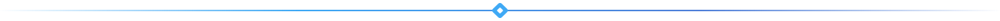
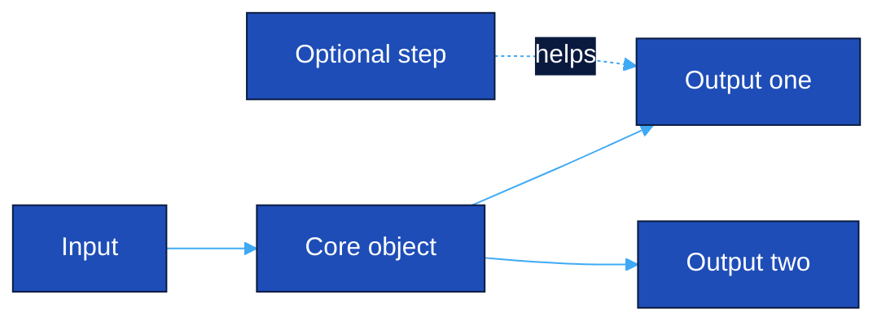
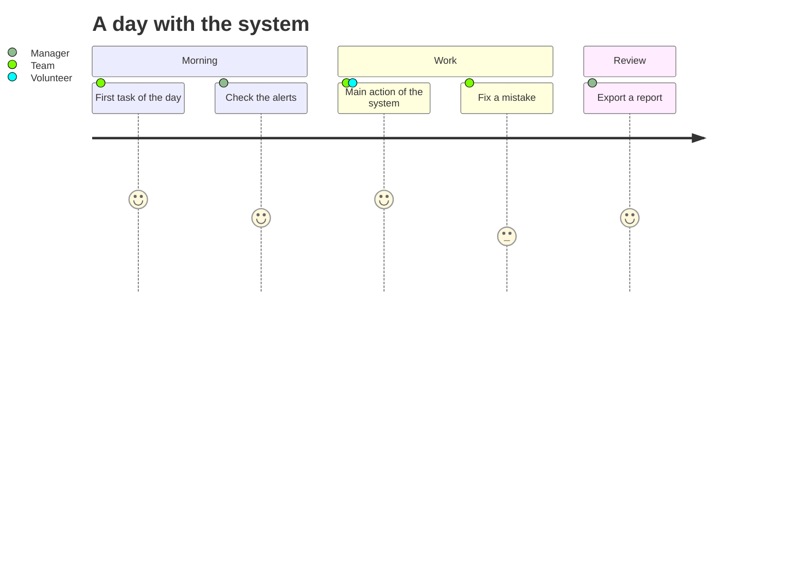
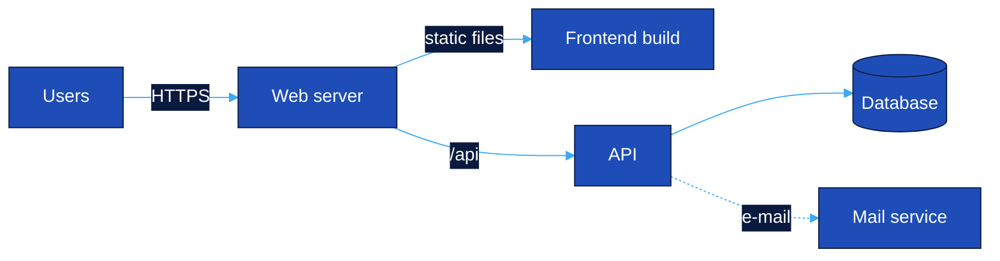

<!-- BANNER (copie a pasta assets/ para o seu projeto e troque "../assets/" por "assets/" em todas as imagens. Edite os textos e as cores dentro do banner.svg) -->
<div align="center">


<br/><br/>

<!-- NAV BUTTONS (cada botão é um arquivo nav-*.svg dentro de um link. Troque o href aqui e o texto dentro do nav-*.svg. Para criar outro, copie uma linha) -->
<!-- CUIDADO! Link dentro de SVG não é clicável, por isso cada botão é um arquivo. Mantenha height="34" em todos. Os links internos usam o título em minúsculas com hífen (## Quick start vira #quick-start) -->
<a href="#quick-start"></a>
<a href="#how-it-works"></a>
<a href="#features"></a>
<a href="#roles"></a>
<a href="#decisions"></a>
<a href="#when-something-breaks"></a>
<a href="docs/DEPLOY.md"></a>

<br/><br/>

<!-- NUMBER CARDS (troque o número dentro de <h2> e o rótulo dentro de <sub>, use de 3 a 5 cartões com fatos do projeto) -->
<table>
  <tr>
    <td align="center" width="150"><h2>5</h2><sub>ROLES</sub></td> <!-- Copie ou apague um bloco <td> para ter mais ou menos cartões -->
    <td align="center" width="150"><h2>12</h2><sub>MODULES</sub></td>
    <td align="center" width="150"><h2>3</h2><sub>LANGUAGES</sub></td>
    <td align="center" width="150"><h2>40</h2><sub>UNIT TESTS</sub></td>
  </tr>
</table>

</div>

<br/>

<!-- WARNING (use só se houver dado real ou risco. Tipos: NOTE, TIP, IMPORTANT, WARNING, CAUTION. Apague o bloco se não precisar) -->
> [!WARNING]
> **Real data.** Say what must never go to the repository, such as the `.env` file, database dumps and keys.

<!-- DIVIDER (esta linha se repete entre as seções, apague onde não quiser) -->


<!-- WHAT IT IS - General Project Description (o que o sistema é, em dois parágrafos curtos e uma tabela de fatos) -->
## What it is

Say in two or three sentences what the system does, for whom and in which context. Start with the problem it solves.

Add one more short paragraph with what the team gets from it day to day.

<!-- FACTS TABLE (troque os rótulos e os valores, mantenha de 4 a 6 linhas) -->
| | |
| :--- | :--- |
| **Who uses it** | The people and the roles |
| **Where it runs** | The server, the domain and how it is served |
| **Built with** | The main technologies |
| **Made by** | Who maintains it and the license |
| **Your data** | Where the data lives and what leaves the server, if anything |

<!-- WHAT DO YOU WANT TO DO (navegação por tarefa, troque as linhas pelos documentos do seu projeto) -->
**What do you want to do?**

| I want to... | Go to |
| :--- | :--- |
| Run the system on my machine | [Quick start](#quick-start) |
| Understand how it works | [How it works](#how-it-works) |
| Put a change online | [docs/DEPLOY.md](docs/DEPLOY.md) |
| Fix something that broke | [When something breaks](#when-something-breaks) |
| Know why it was built this way | [Decisions](#decisions) |


<!-- QUICK START (o caminho mais comum, do clone ao sistema rodando. Só o essencial, o resto vai nos blocos recolhidos) -->
## Quick start

You need **Tool one 20+** and **Tool two 14+**.

<!-- Um passo por bloco, com o endereço onde cada parte fica -->
**1. Backend**, at `http://localhost:3000`

```bash
git clone https://github.com/Username/Repository.git
cd Repository/backend
npm install
cp .env.example .env          # set the variables
npm run dev
```

**2. Frontend**, at `http://localhost:5173`, in another terminal

```bash
cd Repository/frontend
npm install
npm run dev
```

**3. Log in** with the user of the seed and change the password at once.

<!-- ENVIRONMENT VARIABLES (recolhido, liste só as que a pessoa precisa preencher) -->
<details>
<summary><b>Environment variables</b></summary>

<br>

| Variable | What it is |
| :--- | :--- |
| `DATABASE_URL` | The connection to the database |
| `SECRET_KEY` | The key of the login, how to generate one |

</details>


<!-- HOW IT WORKS (de 2 a 4 diagramas Mermaid, troque os textos das caixas) -->
<!-- CUIDADO! Uma linha errada faz o GitHub mostrar um erro no lugar do desenho, e o bloco precisa de uma linha em branco antes e depois -->
## How it works

<!-- MAIN FLOW (cores do diagrama: troque os HEX da primeira linha, primaryColor = caixas e lineColor = setas. Apague a linha para o tema padrão) -->
**The main flow** of the system, from the input to the result:



<!-- USER JOURNEY (um dia de uso do sistema. Formato: "Passo: nota de 1 a 5: quem faz", cada section é um momento do dia) -->
**A day with the system**, as the team lives it:



<!-- PRODUCTION (como roda em produção, troque os nomes das caixas) -->
**In production**, how it runs:




<!-- FEATURES (seis cartões em grade 3 por 2, troque o emoji, o título e a frase) -->
## Features

<table>
  <tr>
    <td width="33%" valign="top"><b>🎯 Feature one</b><br/>One sentence about what it does for the user.</td>
    <td width="33%" valign="top"><b>📊 Feature two</b><br/>One sentence about what it does for the user.</td>
    <td width="33%" valign="top"><b>🔔 Feature three</b><br/>One sentence about what it does for the user.</td>
  </tr> <!-- Copie ou apague uma linha <tr> para ter 3 ou 9 cartões -->
  <tr>
    <td width="33%" valign="top"><b>🔎 Feature four</b><br/>One sentence about what it does for the user.</td>
    <td width="33%" valign="top"><b>🧩 Feature five</b><br/>One sentence about what it does for the user.</td>
    <td width="33%" valign="top"><b>🔐 Feature six</b><br/>One sentence about what it does for the user.</td>
  </tr>
</table>

<!-- FULL LIST (recolhida, uma linha por área, é onde entra o detalhe que não cabe nos cartões) -->
<details>
<summary><b>Everything the system does</b></summary>

<br>

| Area | What it has |
| :--- | :--- |
| **Area one** | What it has, in one line |
| **Area two** | What it has, in one line |

</details>


<!-- ROLES (perfis de acesso, apague a seção se o sistema não tem usuários com permissões diferentes) -->
## Roles

| Role | Who | What it can do |
| :--- | :--- | :--- |
| **ADMIN** | Who holds it | What the role can do |
| **USER** | Who holds it | What the role can do |

Say where the table of permissions lives in the code, and that the backend checks it again.


<!-- DECISIONS (as escolhas do projeto que não devem ser desfeitas sem querer, cada uma com o motivo) -->
## Decisions

Why the system is built the way it is. Each line is a choice that should not be undone by accident.

| Decision | Why |
| :--- | :--- |
| **A choice of the project** | The reason, in one sentence |
| **Another choice** | The reason, in one sentence |


<!-- TESTING (como testar e o que os testes cobrem, diga também o que não é coberto para a pessoa saber onde conferir à mão) -->
## Testing

```bash
npm test
```

Say what the tests cover and what still needs a manual check.

<!-- BACKUPS AND DATABASE (quem faz o backup, com que frequência, como restaurar e como o banco é versionado) -->
<!-- CUIDADO! Só escreva o que você conferiu, não prometa um backup que não existe -->
## Backups and database

Say who makes the backups, how often and how to restore. Say how the schema is versioned and how to change it, and link the longer guide.


<!-- WHEN SOMETHING BREAKS (sintoma, causa e o que fazer, preencha com os erros reais que já aconteceram) -->
## When something breaks

| What you see | Why | What to do |
| :--- | :--- | :--- |
| The message of an error | The cause | The fix |


<!-- WHERE THINGS ARE (mapa curto das pastas e uma tabela com os outros documentos) -->
## Where things are

```
backend/        What lives here
frontend/       What lives here
scripts/        What lives here
docs/           What lives here
assets/         The banner, the divider and the link buttons of this readme
```

<!-- DOCUMENTS TABLE (letra menor com <sub>, troque os documentos pelos do seu projeto) -->
| Document | What it has |
| :--- | :--- |
| <sub>[CHANGELOG](docs/CHANGELOG.md)</sub> | <sub>The notes of every version</sub> |
| <sub>[DEPLOY](docs/DEPLOY.md)</sub> | <sub>How to put a change online</sub> |

<!-- VERSION HISTORY (recolhido, uma linha por versão, da mais antiga para a mais nova) -->
<!-- CUIDADO! O diagrama timeline do Mermaid não está confirmado no GitHub, por isso o histórico é uma tabela -->
<details>
<summary><b>History of the versions</b></summary>

<br>

| Version | What changed |
| :--- | :--- |
| **1.0.0** | The first version |

</details>


<!-- FOOTER (centralizado e pequeno, troque o nome da equipe, o cliente e a frase de licença) -->
<div align="center">

<sub>Made by <b>Team Name</b> for <b>Client Name</b>.</sub><br/>
<sub>For customizations, fixes or support, talk to the team.</sub><br/><br/>
<sub>License of the project, or "Private project, no public license".</sub>

</div>
